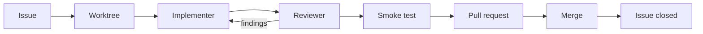

# Getting started with flow

A walkthrough for someone who has never used this kit. It takes you from install to a merged pull
request, then covers the habits that keep the workflow cheap to run. The README lists every
skill. This page is about the order to use them in.

## The idea in one minute

You talk to one Claude Code session. That session does not write the code. It plans, sends agents
to build and check the work, and handles git and GitHub. Every unit of work goes through the same
loop:



Three things follow from that design.

- You steer with short sentences: "deploy an agent to fix this", "how is it so far?", "merge it".
  The sentences load the skills. You never have to name one.
- "Done" means a second agent reviewed the change and something ran the real app. Passing tests
  alone do not count.
- Nothing is committed, pushed or merged until you say it may be.

## Before you start

- A recent Claude Code, signed in, with both plugins installed (see the README).
- The GitHub CLI, signed in. Check with `gh auth status`. The skills assume GitHub.
- A git repository with a GitHub remote.
- An instruction file, `AGENTS.md` or `CLAUDE.md`, that names your gate commands: lint, types,
  tests, build. Agents read it before they touch anything. Step 2 below writes one.
- Optional: the `code-review` and `mattpocock-skills` plugins. `bootstrap/install.sh` adds them.

## Your first session

### 1. Check the setup

Open Claude Code in your repository and run:

```
/flow:start
```

It checks the list above, tells you what is missing with the fix for each item, and proposes a
small first task.

### 2. Give the repository its rules

```
set up AGENTS.md for this repository with the house conventions
```

Claude reads the repository and asks only what it cannot see: the branch you integrate on, squash
or merge commits, who closes issues, whether agents may commit. This file matters more than any
prompt you will type later, because every agent starts by reading it.

### 3. Run one small task through the loop

Pick something that would be a ten-line pull request. A real bug is better than a made-up one.

```
deploy an agent to fix <the bug>. file the issue first.
when it is verified and smoke tested, file the pr.
you have permission to commit and push for this.
```

What happens, in order:

1. Claude files the issue with acceptance criteria.
2. It cuts a worktree and a branch, so your own checkout is never touched.
3. An implementer agent builds the fix and runs the gates.
4. A reviewer agent that did not write the change looks for bugs. Findings go back to the
   implementer, three rounds at most.
5. A verifier runs the real thing and records what it saw.
6. Claude commits, pushes and opens the pull request with the evidence in the body.

While it runs, ask whenever you like:

```
how is it so far?
```

You get about fifteen lines in a fixed order: progress and ETA, what is in flight, what landed,
what is blocked, and a numbered list of what it needs from you.

### 4. Land it and tidy up

```
merge it and close the issue
cleanup
```

The merge waits for CI. The cleanup removes the worktree and branch only after GitHub reports the
pull request as merged.

## A larger piece of work

Design first, then let agents build it in parallel.

```
/grilling <the feature, with the constraints you already know>
```

That command comes from the `mattpocock-skills` plugin. Without it, write "ask me the design
questions for <feature>, numbered, with your recommendation for each". Either way you answer in a
few words:

```
q2 b, q5 keep the old endpoint, agree with the rest
```

Then:

```
file the epic with detailed sub-issues
deploy agents to work on the epic. you manage everything from here.
you may commit, file prs and merge to dev once each one is verified and smoke tested.
```

Claude works the sub-issues in waves of up to three agents and posts progress on the epic. If
your version of Claude Code has `/goal`, set one with an end state someone can check, for example
`/goal complete epic 42, everything verified in the browser`.

## The phrases

| You say | What you get |
|---|---|
| "deploy an agent to fix X" | the whole loop for one issue |
| "you manage everything from here" | Claude orchestrates and stops asking about routine steps |
| "work here, no branch" | a direct edit in your checkout, no agents |
| "how is it so far?" / "whats next?" | a status report, or a ranked list of next actions |
| "what do you need from me?" | only the steps that are yours, with exact commands |
| "make sure it's smoke tested" / "how was it verified?" | the real app is run, and you see the commands and output |
| "file the pr" / "merge it" / "close the issue" | the shipping steps, with guards |
| "investigate without bias" | a fresh agent that has not seen the first diagnosis |
| "can I compact this session?" | state is written to notes, then a yes or no |
| "I'm going to sleep, anything needed from me?" | blockers cleared now, a queue for the night, a recap in the morning |
| "cleanup" | servers stopped, merged worktrees removed, disk reported |

If a sentence does not load the skill you expected, name it: `/flow:orchestrate`,
`/flow:status-report`, and so on.

## Habits that keep it cheap

1. **Match the tool to the job.** One unit of work runs at least three agents: implementer,
   reviewer, verifier. That is several times the tokens of a direct edit. Use the loop for
   anything worth a pull request. For a one-line change say "work here".
2. **Start with one agent.** Three at once is the default cap, and all of them draw on the same
   usage limit as your main session. Go parallel once the first loop has run clean in your
   repository. Say "stay within the session limit" when a wave is large.
3. **Grant narrowly, once.** "You have permission to commit, file prs and merge for this epic"
   removes dozens of questions. A grant covers one repository and one goal. It does not carry to
   the next conversation.
4. **Answer by number.** Claude numbers every choice. "Do 1 and 3" and "agree with the rest" are
   complete answers.
5. **Ask for evidence.** "How was it verified?" should come back with commands and their output,
   plus a plain statement of what could not be checked.
6. **Keep the main session out of the code.** Its context is the scarce resource. If it starts
   reading files to answer a question, say "you're the orchestrator, deploy an agent".
7. **Save before you compact.** Ask "can I compact this session?" first. Agents in flight can
   only be resumed if their ids and worktrees were written down.
8. **Hand over before you leave.** One question at bedtime finds the blocker that would otherwise
   stop the night at 02:00.
9. **Close the day with "cleanup".** Worktrees, containers and dev servers pile up fast when
   three agents work in parallel.

## Making it yours

- **Models.** The three agents run on Opus: the implementer and verifier at high effort, the
  reviewer at xhigh. Override per task in plain words ("use sonnet for the implementers"), or
  fork the repository and edit the `model` and `effort` lines in `plugins/flow/agents/`.
- **Repository rules win.** Merge style, branch names, who closes issues and whether agents may
  commit belong in your `AGENTS.md`. The skills defer to it.
- **Slots.** "Run at most two agents" or "you can run five" changes the cap for the session.
- **Standing rules.** "From now on ..." is written to Claude's memory for that project. Rules for
  every project go in `~/.claude/CLAUDE.md`. `bootstrap/CLAUDE.global.md` is a starting point.

## When it does not do what you expect

| What you see | What to do |
|---|---|
| Claude edits code itself instead of sending an agent | Say "you're the orchestrator, deploy an agent" |
| An agent finishes but nothing is committed | Give the grant: "you have permission to commit and push" |
| A command is refused by the permission system | Ask "what do I need to run?" and paste the line it gives you |
| Agents died at a usage limit | After the reset say "continue, the limits are reset". They resume with their context |
| The review keeps finding things | After three rounds Claude closes the gaps itself or files follow-up issues. Ask for the list |
| "Smoke tested" with no proof | Ask "how was it verified?". No commands and output means it was not |
| The skill list looks stale after an update | `/reload-plugins` |

## Reading further

- [Brief templates](../plugins/flow/skills/orchestrate/references/briefs.md) for the four agent
  roles, if you want to see what the agents are told
- [Traps](../plugins/flow/skills/orchestrate/references/traps.md) and
  [git traps](../plugins/flow/skills/ship-pr/references/git-traps.md), each with the incident
  behind it
- [Models and usage limits](../plugins/flow/skills/orchestrate/references/models-and-limits.md)
- [A starter AGENTS.md](../plugins/flow/skills/repo-conventions/references/AGENTS.template.md)
